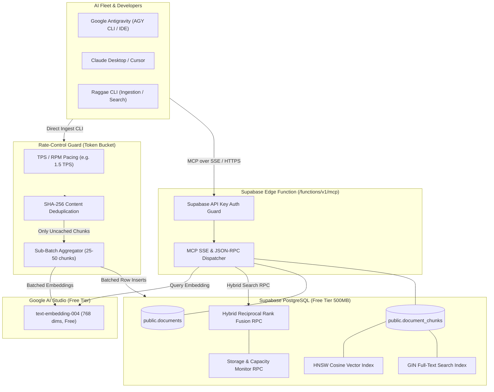
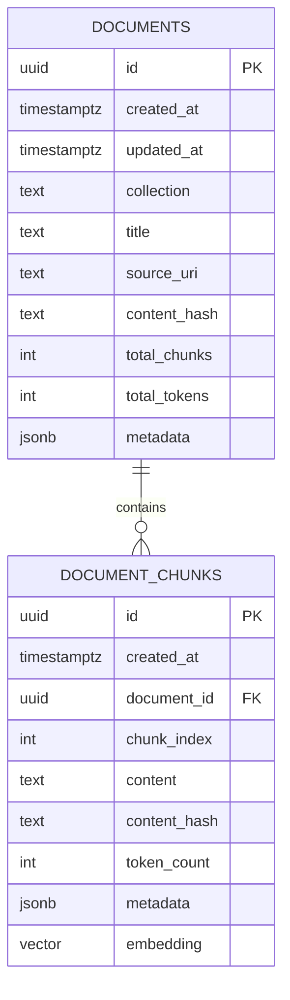

# Raggae: Serverless Free-Tier Hybrid RAG Engine on Supabase Edge & pgvector

[](https://github.com/net-pilgrim/raggae/actions/workflows/deploy.yml)
[-3ECF8E?logo=supabase)](https://supabase.com)
[-4285F4?logo=google)](https://aistudio.google.com)
[](https://modelcontextprotocol.io)
[-brightgreen)](https://supabase.com/pricing)

**Raggae** is a production-grade, 100% serverless, zero-cost Retrieval-Augmented Generation (RAG) and hybrid search system built specifically to stay **permanently inside the free tiers** of Supabase and Google AI Studio.

Designed in the exact same serverless edge architecture as [Mnesia](https://github.com/net-pilgrim/mnesia), Raggae empowers autonomous AI agent fleets (Google Antigravity/AGY, Claude Desktop, Cursor, LangGraph, AutoGen) and CLI developers to ingest, chunk, embed, and retrieve knowledge with **mathematically guaranteed rate control** and storage budget enforcement.

- ❌ **No Docker containers, VPS instances, or local server daemons**
- ❌ **No paid cloud vector databases (Pinecone, Qdrant Cloud, Weaviate)**
- ❌ **No quota overruns or unexpected bills**
- ✅ **100% Serverless Edge execution** ($0.00/month on Supabase Free Tier)
- ✅ **Dual Hybrid Retrieval**: Dense vector cosine similarity (`pgvector` HNSW) + English Full-Text Search (GIN `to_tsvector`) combined via Reciprocal Rank Fusion (RRF)
- ✅ **Google Gemini 768-dim Embeddings**: `text-embedding-004` (100% free via Google AI Studio)
- ✅ **Client-Side Token Bucket Rate Limiting**: Strict Transactions-Per-Second (TPS) and Requests-Per-Minute (RPM) throttling
- ✅ **Adaptive Backoff with Jitter**: Automatically pauses and recovers if HTTP 429 occurs
- ✅ **SHA-256 Deduplication**: Unchanged documents and chunks are never re-embedded or duplicated, saving 100% of API calls on repeated runs
- ✅ **Sub-batch Vector API Calls**: Bundles up to 25–100 passages per embedding API request (`batchEmbedContents`)
- ✅ **MCP over SSE & HTTP**: Turnkey tools for AI agents (`rag_search`, `rag_ingest_document`, `rag_storage_stats`, etc.)
- ✅ **Automated CI/CD & 7-Day Keep-Alive**: GitHub Actions auto-deploy and scheduled cron pings to prevent Supabase inactivity auto-pause

---

## 🏗️ Architecture & How It Works



---

## 💰 Free Tier Budget & Quota Engineering

To ensure Raggae runs indefinitely without paying a single cent, every component is engineered around cloud provider free quotas:

### 1. Database Storage (Supabase Free Tier: 500 MB)
- Vector dimensions: **768 dimensions** (`float4` = 3,072 bytes per vector).
- PostgreSQL row overhead + content text (~1,000 chars) + HNSW index (`m=16, ef_construction=64`): **~4.5 KB per chunk**.
- **Theoretical Capacity**: 500 MB / 4.5 KB ≈ **~110,000 indexed chunks**.
- In terms of text: **~27,500,000 words** (~100 books or thousands of code files) fit comfortably in the free database!
- Check live headroom anytime using `raggae stats` or the `rag_storage_stats` MCP tool.

### 2. Embedding Quota (Google AI Studio Free Tier)
- Model: `text-embedding-004` (768 dimensions).
- Free limit: **100 to 1,500 requests per minute** (RPM) and **1,500 requests per day** (RPD).
- Ingestion batching: With `--batch-size 25`, ingesting 1,000 chunks consumes only **40 API requests** instead of 1,000 requests.
- SHA-256 Cache: Re-indexing or updating existing documents reuses previously embedded chunks directly from the database with **zero API consumption**.

### 3. Edge Function Invocations (Supabase Free Tier: 500,000 calls / month)
- Edge functions handle agent MCP requests and queries over streaming SSE.
- 500,000 calls per month allows ~16,600 agent queries per day.

### 4. Supabase 7-Day Inactivity Auto-Pause Prevention
- Supabase free projects auto-pause after 7 consecutive days without database queries.
- Raggae includes a GitHub Actions scheduled workflow ([keepalive.yml](file:///.github/workflows/keepalive.yml)) that pings the health endpoint twice a week, keeping your database permanently active.

---

## 🗄️ Database Data Model



---

## 🚀 Quickstart Guide

### 1. Create Supabase Project
1. Go to [database.new](https://database.new) and create a free Supabase project.
2. Open the **SQL Editor** in the Supabase Dashboard.
3. Paste the contents of [schema.sql](file:///schema.sql) and click **Run**.
   - Enables `vector` and `pg_trgm` extensions.
   - Creates `documents` and `document_chunks` tables with HNSW and GIN indexes.
   - Installs `match_document_chunks_hybrid` and `get_rag_stats` functions.

### 2. Obtain a Free Gemini API Key
1. Go to [Google AI Studio](https://aistudio.google.com/).
2. Click **Get API key** -> **Create API key in new project** (100% free, no credit card required).

### 3. Configure Local Environment
Copy `.env.example` to `.env`:

```bash
cp .env.example .env
```

Fill in your project credentials:
```env
SUPABASE_URL=https://your-project.supabase.co
SUPABASE_SERVICE_ROLE_KEY=eyJhbGciOi...
GEMINI_API_KEY=AIzaSy...
RAGGAE_TPS=1.5
RAGGAE_BATCH_SIZE=25
```

---

## 💻 CLI Usage: Rate-Controlled Ingestion & Search

The Raggae CLI is zero-dependency (runs on standard Node.js 18+ / 20+ / 22+).

### Ingest Files or Directories
Ingest documentation or codebases with a strict rate limiter (e.g. 1.5 TPS):

```bash
# Ingest a single file
./bin/raggae.mjs ingest docs/architecture.md --collection docs

# Ingest an entire directory with rate control
./bin/raggae.mjs ingest ./src --collection codebase --tps 1.5 --batch-size 25

# Offline dry-run (inspect chunks & token count without API calls)
./bin/raggae.mjs ingest ./docs --dry-run
```

**Ingestion Output Example:**
```text
🚀 Raggae Free-Tier Ingestion Engine
--------------------------------------------------
Target:       ./docs
Collection:   docs
Rate Control: 1.5 TPS (Token Bucket)
Batch Size:   25 chunks/req
Chunk Size:   1000 chars (overlap: 150)
--------------------------------------------------
Found 12 file(s) to process.

[1/12] docs/guide.md ... ✅ Indexed (8 chunks, 8 cached)
[2/12] docs/api.md ... ✅ Indexed (14 chunks, 0 cached)
[3/12] docs/faq.md ... ⏭️  Skipped (unchanged)

==================================================
🎉 Ingestion Summary:
Documents Processed: 2
Documents Skipped:   1 (unchanged)
Chunks Ingested:     22
New Embeddings:      14
Vectors Reused:      8 (zero API cost)
Total Time Elapsed:  3.2s
==================================================
```

### Search from Terminal
Execute hybrid vector + keyword queries:

```bash
./bin/raggae.mjs search "How does rate limiting prevent 429 errors?" --collection docs --limit 5
```

### Inspect Free Tier Headroom
Monitor storage consumption and capacity limits:

```bash
./bin/raggae.mjs stats
```

**Stats Output Example:**
```text
📊 Raggae Supabase Free-Tier Storage Report
==================================================
Documents Count:            48
Total Chunks:               312
Embedded Chunks:            312
Collections:                3
--------------------------------------------------
Total DB Storage Used:      2.84 MB / 500.0 MB
Table Data:                 1.12 MB
Vector & FTS Indexes:       1.72 MB
Free Tier Utilization:      0.57%
Headroom Remaining Chunks:  ~142,000 chunks
==================================================
```

### List Documents
```bash
./bin/raggae.mjs list --collection docs
```

---

## 🤖 AI Agent Fleet Setup (Model Context Protocol)

Raggae natively exposes an MCP server over Server-Sent Events (SSE) and HTTP.

### Supabase Edge Deployment
You can deploy automatically via GitHub Actions:
1. Add the following secrets in your GitHub repository (**Settings -> Secrets and variables -> Actions**):
   - `SUPABASE_ACCESS_TOKEN` (from [supabase.com/dashboard/account/tokens](https://supabase.com/dashboard/account/tokens))
   - `SUPABASE_URL` (e.g. `https://xyzcompany.supabase.co`)
   - `GEMINI_API_KEY` (from Google AI Studio)
2. Push to `main` or trigger the **Deploy Raggae MCP Edge Function** workflow manually.

### Connecting to Google Antigravity (AGY CLI / IDE)
Add Raggae to your MCP server configuration (`~/.gemini/antigravity-cli/mcp.json` or project settings):

```json
{
  "mcpServers": {
    "raggae": {
      "url": "https://<your-project-ref>.supabase.co/functions/v1/mcp/sse",
      "headers": {
        "apikey": "<your-supabase-anon-or-service-key>"
      }
    }
  }
}
```

### Connecting to Claude Desktop
Add to `claude_desktop_config.json`:

```json
{
  "mcpServers": {
    "raggae": {
      "command": "npx",
      "args": ["-y", "mcp-proxy", "https://<your-project-ref>.supabase.co/functions/v1/mcp/sse", "--headers", "apikey=<your-supabase-key>"]
    }
  }
}
```

---

## 🛠️ MCP Tools Reference

Tool | Description | Key Arguments
:--- | :--- | :---
`rag_search` | Hybrid vector & keyword search with Reciprocal Rank Fusion | `query`, `collection`, `limit`, `hybrid`
`rag_ingest_document` | Ingest text/markdown with automatic chunking & caching | `title`, `content`, `collection`, `source_uri`
`rag_list_documents` | List stored documents with metadata and timestamps | `collection`, `limit`
`rag_get_document` | Retrieve full document content and chunk breakdown | `document_id` or `title`
`rag_delete_document` | Remove document and all cascading chunks | `document_id` or `source_uri`
`rag_storage_stats` | Inspect Supabase 500MB storage usage & chunk headroom | *(none)*

---

## 🛡️ License

MIT License. Free to use, adapt, and deploy across commercial and personal agent fleets.
